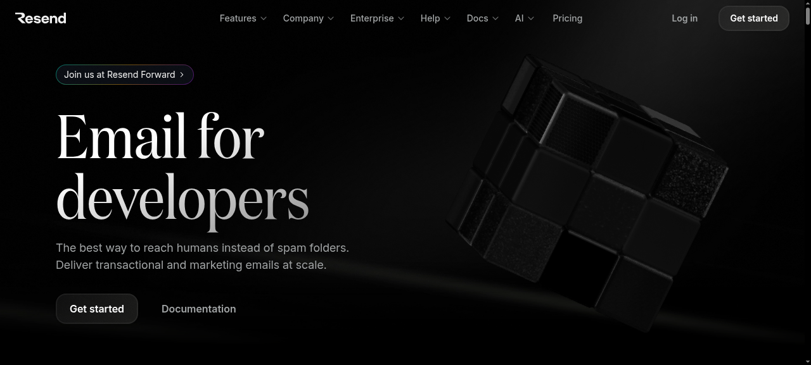

<h1>
  
  Resend quicklink for YunoHost
</h1>

A dashboard tile that links out to [Resend](https://resend.com) — the email
API service for developers. No local service is run: nginx answers with a
302 redirect to `https://resend.com/`, and the portal shows a Resend logo
tile.

**Shipped version:** 1.0~ynh1

## Features

- Portal tile with the Resend logo, quicklink to resend.com
- Pure nginx redirect — no app process, no database

## Screenshots

## Links

- Upstream: <https://resend.com>
- YunoHost package: <https://github.com/quartztester/resend_ynh>
